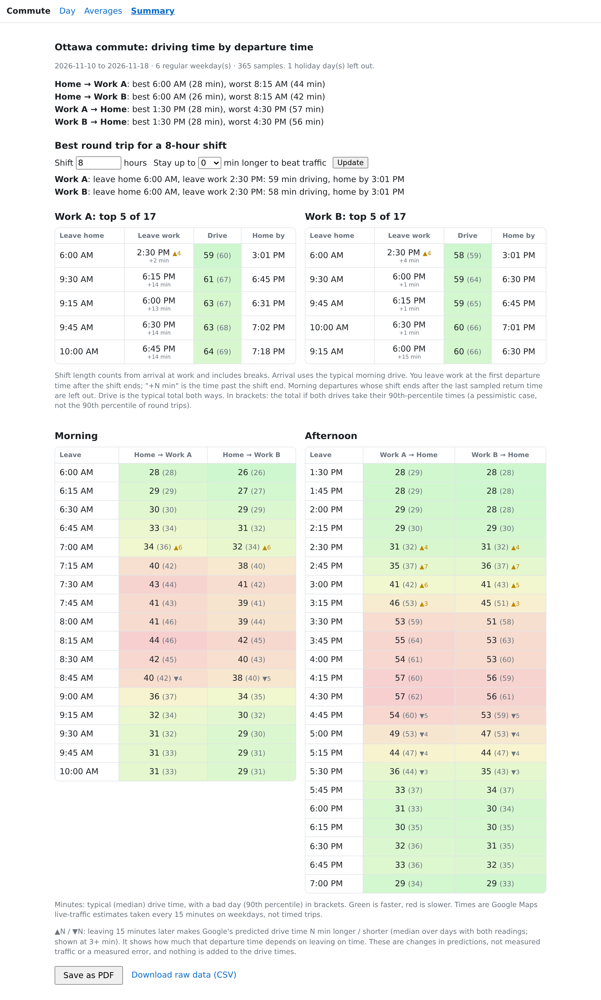
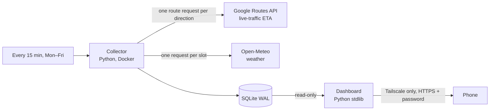
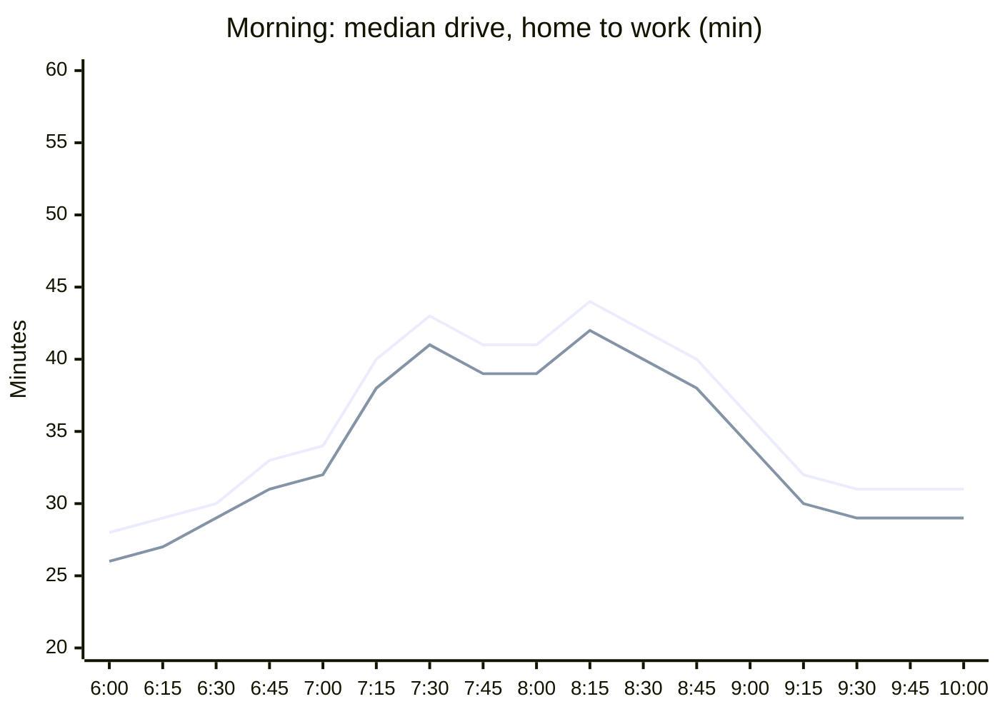
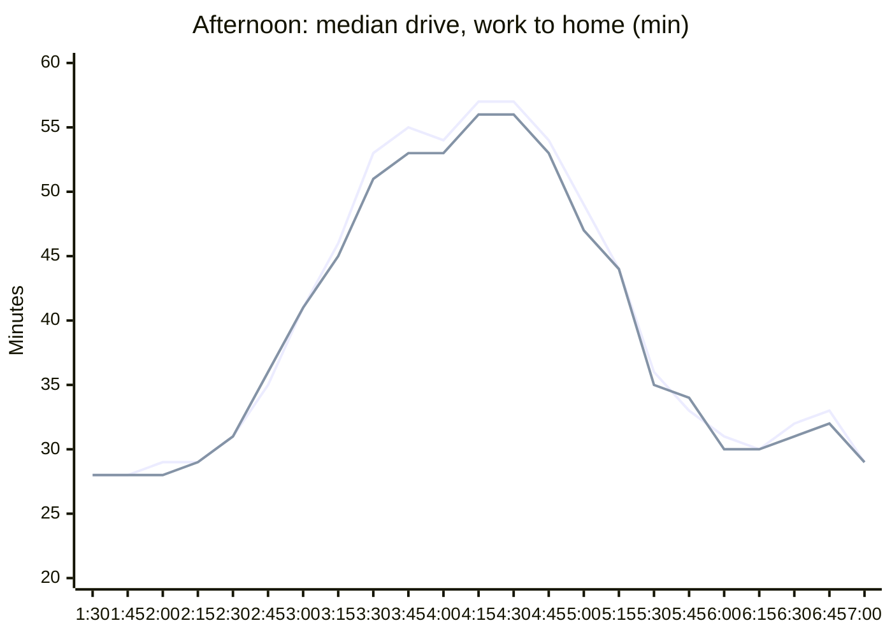
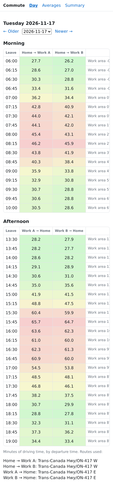

# City Commute Planner

**When should I leave home, and when should I leave work, to spend the least time driving?**

This self-hosted project samples live Google traffic estimates for two commutes every 15 minutes on weekdays. A phone dashboard then shows the best times to leave, based on your shift length.

> Home and work addresses are redacted. The two workplaces are shown as **Work A** and **Work B**. This repository holds the write-up only. The source code is private.

## What it answers

- **Best round trip for your shift.** Enter your shift length (and how long you would stay late to dodge traffic). It ranks every pair of leave-home and leave-work times by total driving time.
- **Typical drive vs. a bad day.** For every departure time, it shows the median drive and the 90th-percentile drive.
- **How much a late start costs.** ▲/▼ marks show where leaving 15 minutes later changes Google's predicted drive by 3 minutes or more.
- **Holidays kept apart.** It tags Ontario, federal, civic and school-board days off and leaves them out of the averages.
- **Weather alongside each sample.** It records temperature, rain and snow for each sample, so you can compare snowy days with clear ones.

## How it works

| Window (weekdays) | Direction | Samples per route |
|---|---|---:|
| 6:00 to 10:00 AM, every 15 min | Home → Work A, Home → Work B | 17 |
| 1:30 to 7:00 PM, every 15 min | Work A → Home, Work B → Home | 23 |

- **One writer, many readers.** A file lock keeps it to a single collector. The dashboard opens the database read-only.
- **No made-up data.** It never fills in missed time slots, and errors get their own rows instead of fake ETAs.
- **Cost caps.** Daily and monthly request caps in the collector keep it inside Google's free monthly allowance.
- **Private by design.** It listens only on `127.0.0.1` and is published to my own devices over Tailscale. Nothing is exposed to the public internet.

## Early results

These come from 6 regular weekdays (Nov 10 to 18, 2026), so expect them to shift as more data comes in.

In both charts, Work A is the upper line and Work B the lower one.

| | Morning | Afternoon |
|---|---|---|
| Fastest departure | 6:00 AM (26 to 28 min) | 1:30 PM (28 min) |
| Slowest departure | 8:15 AM (42 to 44 min) | 4:15 to 4:30 PM (56 to 57 min) |
| Where a late start costs most | 7:00 AM (about +6 min if you leave at 7:15) | 2:45 PM (about +6.5 min if you leave at 3:00) |

**Best round trip on an 8-hour shift:** leave home at 6:00 AM and leave work at 2:30 PM. That's about 58 to 59 minutes of driving for the day. Leaving home after 7:00 AM pushes the drive home into the 3:30 to 5:00 PM peak.

## The phone dashboard

- **Day.** Every sample for one day, with weather, coloured from fastest to slowest.
- **Averages.** Mean drive per departure time and weekday, with holidays listed separately.
- **Summary.** The round-trip planner and the median and 90th-percentile tables. It fits on one printed page (Save as PDF) and comes with a CSV export.

## Limits

- These are Google's **predicted** drive times when the sample was taken, not timed trips. The data cannot show how far a prediction was from the real drive.
- Arrival at work in the planner uses the typical (median) morning drive.
- The bad-day figure in the planner assumes both drives take their 90th-percentile times. It is a pessimistic case, not the 90th percentile of whole round trips.

## Stack

Python 3 (standard library only), SQLite in WAL mode, Docker Compose, Google Routes API, Open-Meteo and Tailscale Serve. It runs on a small home server.
